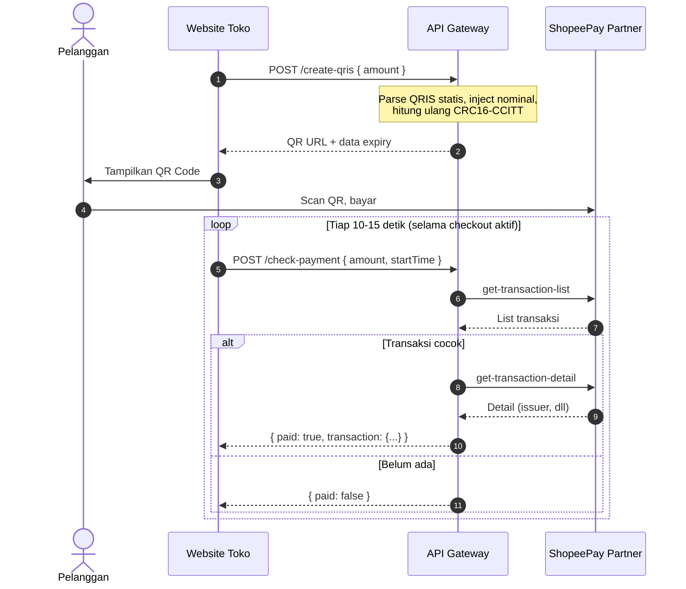

# ShopeePay Partner API Gateway (Stateless)

[](https://nodejs.org)
[](https://expressjs.com)
[](LICENSE)

Gateway API untuk otomasi verifikasi mutasi transaksi ShopeePay Partner, validasi token, riwayat bulanan, dan pembuatan QRIS dinamis dari QRIS statis. Berjalan tanpa database dan tanpa background polling.

---

> **Disclaimer: Unofficial Gateway**
>
> Proyek ini **tidak berafiliasi** dengan PT. Shopee International Indonesia atau Sea Group.
>
> Gateway membaca data dari ShopeePay Partner Portal menggunakan sesi akun merchant Anda sendiri (token internal). Token dan API Key disimpan di `.env` di server Anda, tidak pernah dikirim ke pihak lain selain server ShopeePay Partner.
>
> Semua operasi bersifat **read-only**: hanya membaca mutasi, tidak mengubah saldo atau menarik dana. Tidak ada layanan cloud pihak ketiga, webhook publik, atau proxy eksternal. Traffic berjalan langsung dari server Anda ke `shopeepay.shopee.co.id`.
>
> **Penggunaan sepenuhnya menjadi tanggung jawab pengguna.**

---

## Alur Pengecekan



Gateway hanya memanggil API Shopee saat ada request dari toko. Saat toko sepi, jumlah request ke Shopee adalah nol.

---

## Fitur

- **Tanpa database**: semua state di memori. Cocok untuk cloud serverless (Render, Railway, dll) yang restart berkala.
- **QRIS dinamis**: parsing TLV pada QRIS statis, inject nominal (Tag 54), hitung ulang CRC16-CCITT.
- **Polling berbasis client**: aktivitas ke Shopee mengikuti jumlah checkout aktif. Tidak ada cron job.
- **Multi-token**: kirim token Shopee berbeda lewat header `X-Shopee-Token` per request.
- **Deteksi issuer**: ambil detail transaksi untuk mengetahui metode pembayaran (Seabank, OVO, DANA, BCA, dll).
- **Validasi token + Telegram alert**: cek token tiap 5 menit. Kirim notifikasi ke Telegram jika token mati.
- **Anti-double claim**: `transactionId` yang sudah diklaim disimpan di RAM (auto-purge 24 jam).
- **Circular log**: 100 log terakhir bisa diakses lewat `/api/logs`.

---

## Penanganan Nominal Kembar

Karena gateway tanpa database, dua checkout dengan nominal sama bisa menyebabkan double-claim. Pengaman:

1. **Di sisi gateway**: `transactionId` yang sudah divalidasi disimpan di Map (RAM). Request berikutnya dengan ID yang sama diabaikan selama 24 jam.
2. **Rekomendasi di sisi toko**:
   - Tambahkan kode unik (Rp 1 s/d Rp 99) pada nominal tagihan.
   - Simpan `transactionId` dari respons sukses ke database toko. Tolak jika sudah terdaftar.

---

## Setup

### 1. Clone dan install

```bash
git clone https://github.com/iqraa07/shoppepay-api-gateway.git
cd shoppepay-api-gateway
npm install
```

### 2. Konfigurasi `.env`

```bash
cp .env.example .env
```

Isi file `.env`:

```env
PORT=4000
SHOPEE_TOKEN=token_dari_partner_portal
API_KEY=api_key_untuk_autentikasi
TELEGRAM_BOT_TOKEN=bot_token_telegram
TELEGRAM_CHAT_ID=chat_id_telegram
QRIS_STATIC=string_qris_statis_merchant
```

### 3. Dapatkan `SHOPEE_TOKEN`

1. Login ke [ShopeePay Partner Portal](https://partner.shopee.co.id/).
2. Buka DevTools (F12) > tab **Network** > filter **Fetch/XHR**.
3. Refresh halaman transaksi.
4. Cari request ke endpoint yang mengandung `/partner-web/`.
5. Di payload request, cari field `metadata.token`. Itu token Anda.

### 4. Jalankan

```bash
node server.js
```

Server berjalan di `http://localhost:4000`.

---

## API Endpoints

Semua endpoint (kecuali `/`, `/api/health`, dan `/qr/:id`) memerlukan header `x-api-key` atau query param `api_key`.

### Health Check

```
GET /api/health
```

### Update Token

```
POST /update-token
Body: { "token": "token_baru" }
```

### Cek Status Token

```
GET /token-status
```

### Buat QRIS Dinamis

```
POST /create-qris
Body: { "amount": 50000 }
```

Respons:

```json
{
  "success": true,
  "data": {
    "qris_url": "http://localhost:4000/qr/abc12345",
    "amount": 50000,
    "expires_at": "2024-01-01 12:15:00",
    "expires_in": "15 menit"
  }
}
```

### Redirect QR Image

```
GET /qr/:id
```

Redirect ke gambar QR code. Return 404 jika tidak ditemukan, 410 jika expired.

### Verifikasi Pembayaran

```
POST /check-payment
Body: { "amount": 50000, "startTime": 1704067200 }
```

`startTime` opsional (unix timestamp). Default: 30 menit lalu.

Respons jika sudah dibayar:

```json
{
  "success": true,
  "paid": true,
  "transaction": {
    "transactionId": "SP1234567890",
    "amount": 50000,
    "status": "success",
    "time": "2024-01-01 12:05:00",
    "issuer": "OVO"
  }
}
```

### Daftar Transaksi

```
GET /transactions?startTime=...&endTime=...&pageSize=10
```

### Semua Transaksi Bulan Ini

```
GET /transactions/all
```

Pagination otomatis, delay 500ms antar batch.

### Log Aktivitas

```
GET /api/logs
```

100 log terakhir.

---

## Deploy

Script `deploy.sh` tersedia untuk deploy ke server. Sesuaikan variabel di dalamnya sebelum digunakan.

```bash
chmod +x deploy.sh
./deploy.sh
```

---

## Struktur File

```
├── .env.example      # Template konfigurasi
├── server.js          # Seluruh logic gateway (single file)
├── package.json       # Dependencies
├── deploy.sh          # Script deploy
└── README.md
```

---

## Lisensi

MIT
